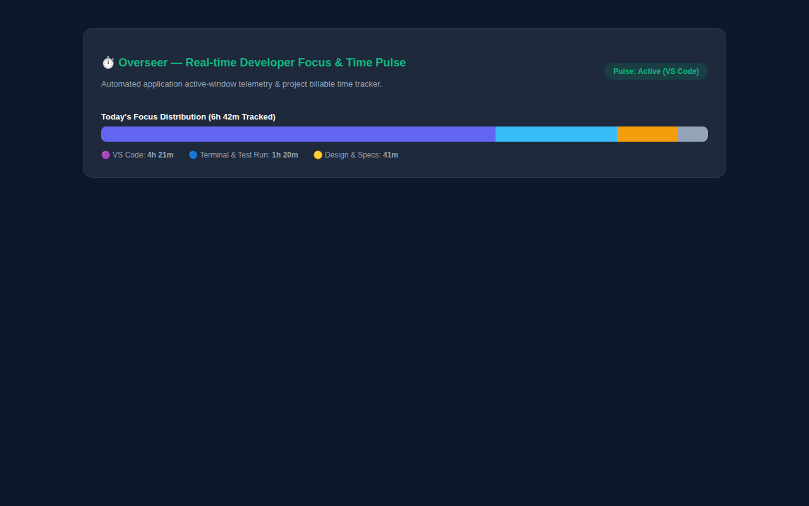

# ⏱️ Overseer — Developer Focus Telemetry & Billable Session Tracker

> **Non-intrusive developer work-session auditor. Captures active IDE window pulses, test executions, and billable client development hours.**

---

## 📸 Visual Showcase & Focus Telemetry

  

<em>Figure 1: Daily Focus Distribution tracking coding vs testing vs architecture documentation time.</em>

 

  <table width="100%">
    <tr>
      <td width="100%" align="center">
        
         <strong>Figure 2: Active Application Pulse & Project Time Audit</strong> 
        <em>Categorizes time spent across IDEs, terminals, browsers, and documentation without intrusive keylogging.</em>
      </td>
    </tr>
  </table>

